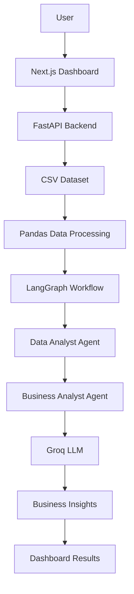
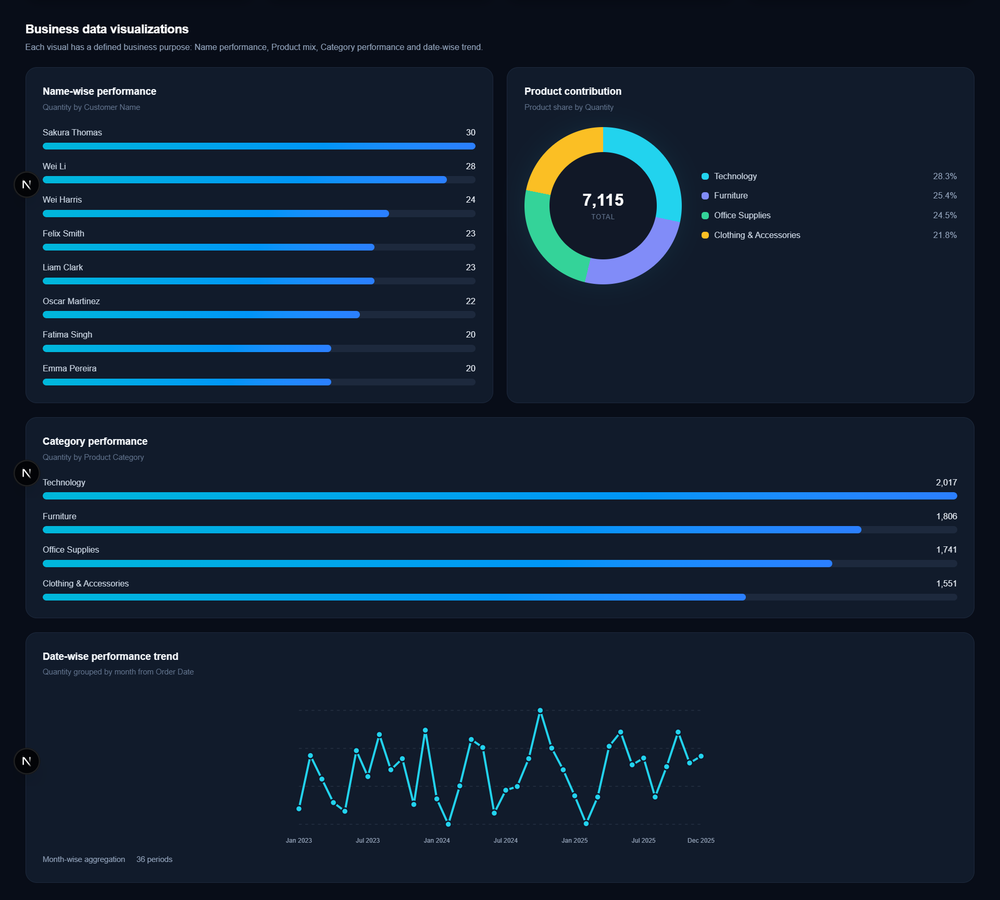
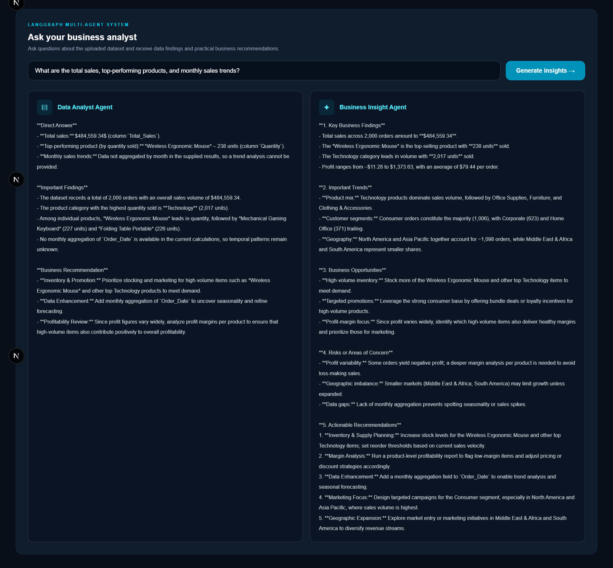

# AI Business Intelligence Multi-Agent System
An AI-powered business intelligence platform that transforms uploaded CSV datasets into interactive analytics, data-driven business insights, and AI-generated answers using a multi-agent workflow.

## Overview
The AI Business Intelligence Multi-Agent System combines traditional data analytics with Generative AI to help users understand business data and make informed decisions.
Users can upload business datasets, explore automatically generated KPIs and visualizations, and ask natural-language questions. Specialized AI agents collaborate through a LangGraph workflow to analyze data and generate actionable business insights.

## Key Features
- **CSV Dataset Upload:** Upload and analyze business datasets.
- **Automated Data Analysis:** Generate dataset summaries, identify numerical columns, and preview records.
- **Dynamic KPI Dashboard:** Calculate business metrics such as total revenue, profit, orders, and average order value based on available dataset columns.
- **Interactive Visualizations:**
  - Bar charts for category-wise performance.
  - Pie/Donut charts for product or category distribution.
  - Line charts for date-wise trends.
  - Histograms for numerical data distribution.
- **Multi-Agent AI Workflow:** Specialized Data Analyst and Business Analyst agents collaborate to answer business questions.
- **Natural Language Querying:** Ask questions about uploaded datasets without manually writing SQL or Python queries.
- **AI-Generated Business Insights:** Receive analytical explanations and business recommendations.
- **PDF Report Generation:** Export dashboard reports containing KPIs, visualizations, and dataset information.
- **Web Deployment:** Frontend hosted on Vercel and backend deployed on Render.

## Technology Stack
| Category | Technologies |
|---|---|
| Programming Language | Python, TypeScript |
| Frontend | Next.js, React, Tailwind CSS |
| Backend | FastAPI |
| AI Framework | LangChain, LangGraph |
| LLM Provider | Groq API |
| Data Processing | Pandas |
| Data Visualization | Interactive dashboard charts |
| Deployment | Vercel, Render |
| Version Control | Git, GitHub |

## Multi-Agent Architecture
The application uses a workflow-based multi-agent architecture.

### 1. Data Analyst Agent
- Examines the uploaded dataset.
- Performs data analysis based on the user's question.
- Identifies relevant patterns and numerical findings.
- Produces structured analytical results.

### 2. Business Analyst Agent
- Interprets the analytical results.
- Identifies business trends and opportunities.
- Generates actionable business insights.
- Provides business-oriented recommendations.

### Workflow


## Application Workflow
1. Open the web application.
2. Upload a CSV business dataset.
3. The backend processes the dataset using Pandas.
4. The dashboard displays calculated KPIs and visualizations.
5. Enter a business-related question in the AI analysis section.
6. The Data Analyst agent analyzes the dataset.
7. The Business Analyst agent interprets the analysis.
8. View the generated answers and business insights.
9. Export the dashboard report as a PDF.

## Dashboard Screenshots
The following screenshots demonstrate the application's interface.

### Dashboard Overview


### Business Analytics


### AI Business Insights


## Project Structure
```text
AI-Business-Intelligence-Multiagent/
│
├── agents/
│   ├── business_insight.py
│   └── data_analyst.py
│
├── graph/
│   └── workflow.py
│
├── utils/
│   └── data_summary.py
│
├── frontend/
│   ├── app/
│   │   └── page.tsx
│   ├── package.json
│   └── ...
│
├── screenshots/
│   ├── dashboard-overview.png
│   ├── business-analytics.png
│   └── ai-business-insights.png
│
├── api.py
├── requirements.txt
└── README.md
```

## Installation and Setup
### Prerequisites
- Python 3.10+
- Node.js and npm
- Git
- Groq API Key

### 1. Clone the Repository
```bash
cd AI-Business-Intelligence-Multiagent
```

### 2. Backend Setup
Create and activate a virtual environment.
```bash
python -m venv myenv
```

Windows PowerShell:
```powershell
.\myenv\Scripts\Activate.ps1
```

Install dependencies:
```bash
pip install -r requirements.txt
```

Create a `.env` file in the project root:
```env
GROQ_API_KEY=your_groq_api_key
```

Start the FastAPI backend:
```bash
uvicorn api:app --reload
```

Backend API:
```text
http://127.0.0.1:8000
```

API documentation:
```text
http://127.0.0.1:8000/docs
```

### 3. Frontend Setup
Open another terminal:
```bash
cd frontend
npm install
```

Create a `.env.local` file inside the frontend folder:
```env
NEXT_PUBLIC_API_URL=http://127.0.0.1:8000
```

Start the frontend:
```bash
npm run dev
```

Open:
```text
http://localhost:3000
```

## Environment Variables
| Variable | Description |
|---|---|
| GROQ_API_KEY | API key used for LLM access |
| NEXT_PUBLIC_API_URL | Backend API base URL |

**Security Note:** Never commit `.env`, `.env.local`, API keys, or other credentials to GitHub.

For production deployment, configure environment variables through the respective hosting platform.

## API Endpoints
| Method | Endpoint | Description |
|---|---|---|
| GET | `/` | Check API status |
| POST | `/upload` | Upload and process CSV dataset |
| GET | `/analytics` | Retrieve generated KPIs and charts |
| POST | `/ask` | Submit business questions to the AI workflow |

## Deployment
The application is deployed using:
- **Frontend:** Vercel
- **Backend:** Render

Live Application: [Open Application](https://ai-business-intelligence-multiagent-jod9e9a6s.vercel.app)

## Example Business Questions
Users can ask questions such as:
- Which product category generates the highest revenue?
- What are the major sales trends over time?
- Which region contributes the most to business performance?
- What patterns can be identified from the dataset?
- What business opportunities can be identified from the analysis?

The AI agents analyze the uploaded dataset and generate responses based on the available data.

## Learning Outcomes

This project provided practical experience in:
- Building AI-powered applications using Python.
- Developing REST APIs with FastAPI.
- Implementing multi-agent workflows using LangGraph.
- Integrating LLMs through Groq.
- Processing real-world datasets using Pandas.
- Connecting frontend and backend applications.
- Deploying full-stack AI applications.
- Building interactive business intelligence dashboards.

## Future Enhancements
- Advanced customer segmentation.
- Predictive business analytics.
- Automated anomaly detection.
- More specialized AI agents.
- Enhanced data visualization and reporting.


*Developed as a practical project to explore the integration of Generative AI, multi-agent systems, and business intelligence.*
